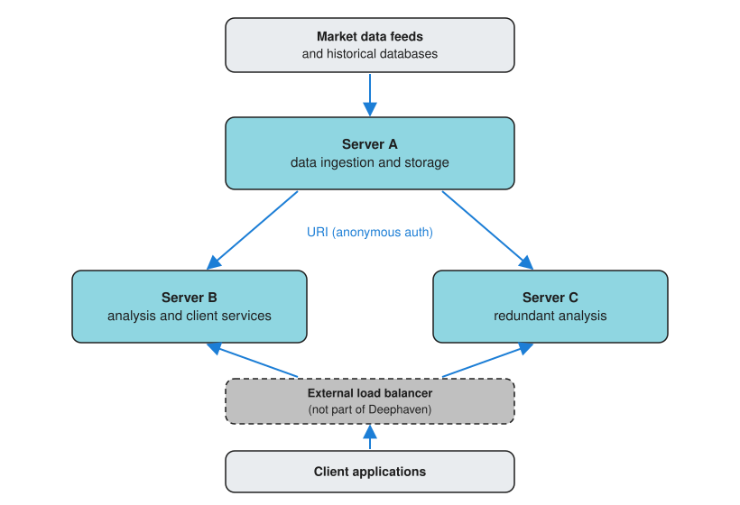

Deephaven offers server-side and client-side APIs in multiple languages. These APIs let you build applications that distribute workloads across multiple machines and share live data. A client, or another Deephaven server, can subscribe to a ticking table, a table whose rows change as new data arrives, and receive each update as it happens.

When should you use server-side APIs? When should you use client-side APIs? When might you need multiple servers? This guide answers these questions by:

- Explaining the differences between client-server and peer-to-peer architectures.
- Covering how Deephaven's server- and client-side APIs work.
- Providing guidance on choosing the right architecture for your application.

## Software architecture

Distributed applications generally follow one of two software architectures. In a client-server architecture, each process is either a client or a server. In a peer-to-peer architecture, a process can be both.

### Client-server software architecture

In a client-server architecture:

- A centralized computer called the server, located on-premises or in the cloud, provides services to users.
- Decentralized processes, called clients, send requests to the server to access services. Clients may be workstations running on people's desks, or more powerful machines running in the machine room or in the cloud.

### Peer-to-peer software architecture

In a peer-to-peer architecture, a process can act as both a client and a server. In this model:

- Each process can both provide and access services.
- Data and processing can be distributed across multiple nodes.
- Processes communicate with each other directly.

## Deephaven servers and clients

A Deephaven server and the clients connected to it follow the [client-server](#client-server-software-architecture) architecture. When you connect a client to a server, the client sends requests over that connection. The server runs them and sends back the results. The server does the heavy lifting. That's where the processing happens.

A Deephaven server can also be a client of another Deephaven server. It can pull that server's tables in two ways: by [URI](../how-to-guides/use-uris.md), or by [capturing a table published to a shared ticket](../how-to-guides/capture-tables.md). In this [peer-to-peer](#peer-to-peer-software-architecture) setup, several servers share tables and split the processing. The [multi-server example](#example-multi-server-application) shows one.

The following snippet shows the URI approach. Running it on one server pulls the `prices` table from the query scope of a second server, `server-a`:

```groovy syntax
import static io.deephaven.uri.ResolveTools.resolve

prices = resolve("dh+plain://server-a:10000/scope/prices")
```

The result is a local table on the receiving server. If `prices` ticks on `server-a`, the local copy ticks with it.

> [!NOTE]
> Both ways of pulling tables into a Groovy server go through [`BarrageTableResolver`](/core/javadoc/io/deephaven/server/uri/BarrageTableResolver.html), which doesn't send credentials. The server that holds the table must accept [anonymous authentication](../how-to-guides/authentication/auth-anon.md). A server that accepts only [pre-shared key (PSK) authentication](../how-to-guides/authentication/auth-psk.md) rejects the connection.

Key characteristics of Deephaven's client-server model:

- **Server-side processing**: The vast majority of computational work happens on the server, which stores and transforms the data.
- **Lightweight clients**: Most clients do little or no data processing. They send requests and receive the results. Two kinds of client run the full engine and can keep processing the tables they receive: the [Java client](../how-to-guides/java-client.md) when it subscribes over Barrage, and a Deephaven server that pulls tables from another server. See [What is Barrage?](./what-is-barrage.md).
- **Ticking table support**: Ticking tables are tables whose rows change as new data arrives (see the [incremental update model](./table-update-model.md)). Clients that support ticking subscribe to a ticking table over Deephaven's [Barrage](./what-is-barrage.md) protocol. They first receive a snapshot of the table, then incremental updates that contain only the changes. [Client APIs](#client-apis) lists which clients support ticking.
- **Language independence**: A client's table operations work with a server regardless of the server's scripting language. For example, a [Python client](/core/docs/getting-started/pyclient-quickstart/) can connect to a server that runs Groovy, and a [Java client](../how-to-guides/java-client.md) can connect to a server that runs Python. Scripts that a client sends to the server must be written in the server's scripting language.

## Deephaven's language support

Deephaven supports languages in two roles: server-side scripting and client APIs.

### Server-side scripting languages

Server-side scripts run directly on the Deephaven server and have full access to the table API for creating, transforming, and managing tables:

- [Python](/core/pydoc/)
- [Groovy](/core/javadoc/)

### Client APIs

Client APIs allow applications written in various languages to connect to a Deephaven server, send requests, and receive table data. Client applications can also send server-side scripts for the server to run. Deephaven provides client APIs in these languages:

- [Python](/core/client-api/python/)
- [Java](/core/javadoc/)
- [C++](/core/client-api/cpp/)
- [R](/core/client-api/r/)
- [JavaScript](/core/client-api/javascript/modules/dh.html)
- [Go](https://pkg.go.dev/github.com/deephaven/deephaven-core/go)
- C# (.NET)

The [Java](../how-to-guides/java-client.md), [JavaScript](../how-to-guides/use-jsapi.md), [C++](/core/client-api/cpp/), and C# clients can subscribe to ticking tables. The [Python client](/core/docs/getting-started/pyclient-quickstart/) can subscribe too when you install the `pydeephaven-ticking` package. The [R](/core/client-api/r/) and [Go](https://pkg.go.dev/github.com/deephaven/deephaven-core/go) clients receive static snapshots.

The Deephaven web UI is itself a client: it runs in the browser and uses the [JavaScript client API](/core/client-api/javascript/modules/dh.html) to display and subscribe to tables.

## Server vs client considerations

One of the challenges of building a distributed application is to decide where to perform different aspects of the computation. As described in [Deephaven servers and clients](#deephaven-servers-and-clients), the server does the data-intensive work, such as [aggregations](./aggregations.md) and streaming [joins](../how-to-guides/joins-exact-relational.md). Use the following guidelines to decide between server-side scripts and client applications:

- **Server-side scripts**: Use them for work that creates or transforms tables, such as ingesting data, [filtering](../how-to-guides/use-filters.md), [joining](../how-to-guides/joins-exact-relational.md), and [aggregating](./aggregations.md). The script runs on the server, next to the data.
- **Client applications**: Use them for work that runs outside the server, such as a separate service, a program written in a language other than Python or Groovy, or a user-facing tool.

Keep heavy table processing on the server where possible. The client decides what to ask for: which [sorts](../how-to-guides/sort.md) and [filters](../how-to-guides/use-filters.md) to apply and which rows are visible. The server runs those operations, whether the client sends them as a script or as calls to its client API.

## Architecture planning considerations

When you design a Deephaven application, several factors influence whether you need one server or many, and how to allocate resources. The following subsections cover the most important considerations.

### Data intensity

Data intensity depends on several factors:

- **Row volume**: More rows processed per unit of time require more memory and CPU.
- **Column count**: Each column that your tables hold in memory, or that your queries read, adds memory and processing cost.
- **Data types**: Numeric data (integers, doubles) is compact and fast to process. Strings, especially long strings or those with high cardinality, consume significantly more memory. Complex types (arrays, nested structures) add further overhead.
- **Data retention**: How long you keep data in memory affects total capacity requirements.
- **Query complexity**: Simple [aggregations](./aggregations.md) have different performance characteristics than complex [joins](../how-to-guides/joins-exact-relational.md) or [rolling (window) operations](../how-to-guides/rolling-aggregations.md).
- **Update frequency**: High-frequency updates to ticking tables create more work than batch updates.

A single server can handle billions of rows of compact numeric data with simple queries, yet struggle with millions of rows that contain large strings and complex [joins](../how-to-guides/joins-exact-relational.md). Capacity planning requires analyzing your specific workload rather than relying on general row-count thresholds.

### Computational resources

Your server architecture depends on matching computational resources to workload requirements:

- **Memory (RAM)**: Deephaven holds in-memory tables and materialized query results in RAM, and reads data from disk-backed sources, such as [Parquet files](../how-to-guides/data-import-export/parquet-import.md), as queries need it. Memory needs depend on the size of your tables (rows × columns × data type sizes), the number of concurrent tables, and intermediate query results. As memory use approaches the JVM heap limit, garbage collection runs more often and slows queries. Exceeding the limit causes an out-of-memory error.
- **CPU cores**: Query operations, [joins](../how-to-guides/joins-exact-relational.md), [aggregations](./aggregations.md), and [formula](../how-to-guides/formulas.md) evaluations benefit from multiple cores. Higher core counts improve throughput for complex queries and allow multiple operations to run in parallel.
- **Disk I/O**: Disk performance matters for operations like loading historical data, writing logs, or writing tables to disk, such as [Parquet files](../how-to-guides/data-import-export/parquet-export.md). Use SSD storage for these operations.
- **Network bandwidth**: For applications sharing data between servers or serving many clients, network capacity can become a bottleneck.

When your workload exceeds what a single server can handle efficiently, add resources to that server or distribute the workload across multiple servers (see [Scalability](#scalability)).

### Specialized workloads

Consider using multiple servers when your application has distinct processing requirements:

- **Data segregation**: When different data sets need to be processed separately for security or compliance reasons.
- **Resource optimization**: When some workloads are CPU-intensive, while others are memory-intensive.
- **Specialized processing**: When different parts of your application require different libraries or configurations.

For example, you might dedicate one server to real-time data ingestion and another to complex analytical queries, and tune each server for its task.

### Scalability

As your application grows, plan how it scales:

- **Vertical scaling**: Adding more resources (RAM, CPU) to a single server has limits and may become cost-prohibitive.
- **Horizontal scaling**: Adding more servers distributes the workload and provides more flexibility.

You can scale horizontally by running more Deephaven servers and sharing tables between them with [URIs](../how-to-guides/use-uris.md) or by [capturing tables published to shared tickets](../how-to-guides/capture-tables.md). Both methods require anonymous authentication on the server that holds the table. The note in [Deephaven servers and clients](#deephaven-servers-and-clients) explains why.

### Data security

Your architecture choices have significant implications for data security. In every topology, clients reach the server over the network, so secure the channels between clients and servers.

The number of servers also matters:

- **Single server**: Simplifies security management with a single point of control but creates a single point of failure.
- **Multiple servers**: Lets you keep data sets apart, but the connections between servers need securing too. Any server that holds tables for other servers must accept anonymous authentication. See the note in [Deephaven servers and clients](#deephaven-servers-and-clients).

Common security aspects that require careful thought when designing application architecture include:

- **Authentication**: How users identify themselves to the system. Deephaven supports [anonymous](../how-to-guides/authentication/auth-anon.md), [pre-shared key](../how-to-guides/authentication/auth-psk.md), [username and password](../how-to-guides/authentication/auth-uname-pw.md), [mTLS](../how-to-guides/authentication/auth-mtls.md), and [Keycloak](../how-to-guides/authentication/auth-keycloak.md) authentication.
- **Authorization**: What data and operations each user can access. By default, Deephaven Community lets every authenticated user perform all operations. Finer-grained access control requires binding a custom [`AuthorizationProvider`](/core/javadoc/io/deephaven/server/auth/AuthorizationProvider.html) when you [run Deephaven from your own Java application](../how-to-guides/configuration/custom-java-application.md).
- **Data encryption**: Whether to encrypt data at rest, [in transit](../how-to-guides/authentication/auth-mtls.md), or both.
- **Network isolation**: Whether servers should be isolated on separate networks.
- **Audit logging**: How you track and monitor user actions.

Address these concerns early in your architecture planning, as they often influence decisions about server topology, network configuration, and client deployment.

## Example architectures

The following examples demonstrate how the planning considerations discussed above lead to different architectural choices.

### Example: Client-server application

Consider a portfolio risk monitoring system for a trading desk. Here's how a Deephaven client-server architecture enables real-time risk management:

**Server side:**

- Runs on a dedicated machine with access to market data feeds and position data.
- Ingests real-time market data (prices, volumes, volatility measures) and continuously updates position valuations.
- Performs complex calculations: Greeks for options positions, Value at Risk (VaR), portfolio exposure by sector/geography, and stress testing scenarios.
- Maintains historical tables of positions, P&L, and risk metrics for compliance and reporting.
- Generates real-time alerts when risk limits are breached.

**Client side:**

- Portfolio managers can view risk dashboards in the Deephaven web UI from their workstations, or pull the data into their own tools with the [Python client](/core/docs/getting-started/pyclient-quickstart/).
- Traders on the desk can query specific position details and hypothetical scenarios from their terminals.
- Risk officers can request custom reports and [filtered](../how-to-guides/use-filters.md) views (e.g., only high-risk positions or specific asset classes).
- Compliance teams can access audit trails and historical snapshots from separate client applications.

This architecture centralizes intensive real-time calculations on the server while allowing diverse users to access the data they need through lightweight clients. Multiple users can read the same underlying tables at the same time without each user re-running the server's calculations. This design also follows the advice in [Choosing your architecture](#choosing-your-architecture) to start with one server, and it keeps security under a single point of control (see [Data security](#data-security)).

### Example: Multi-server application

Multi-server applications distribute workloads across multiple machines to handle high-volume data processing or specialized tasks. This example shows a financial trading application that uses Deephaven's [peer-to-peer](#peer-to-peer-software-architecture) architecture. Servers B and C are clients of Server A, and they are also servers to the client applications. Ingestion and analysis have different resource profiles ([Specialized workloads](#specialized-workloads)), so this design gives each its own server.



**Server A (data ingestion and storage):**

- Ingests high-speed market data from multiple sources:
  - Real-time stock market feeds
  - Cryptocurrency exchanges
  - Futures markets
  - Options data
- Maintains connections to historical databases.
- Performs initial data cleaning and normalization.
- Exposes ticking tables via [URIs](../how-to-guides/use-uris.md) for other servers to access.
- Uses [anonymous authentication](../how-to-guides/authentication/auth-anon.md) because it holds the tables that the other servers resolve by [URI](../how-to-guides/use-uris.md).

**Server B (analysis and client services):**

- Connects to Server A using [URIs](../how-to-guides/use-uris.md) to access live market data.
- Performs complex calculations:
  - Risk analytics
  - Trading signals
  - Portfolio optimization
- Serves processed data to client applications.
- Executes automated trading strategies based on signals.

**Server C (redundant analysis):**

- Runs the same analysis code as Server B and connects to Server A the same way.
- Keeps serving clients when Server B fails or is down for maintenance. Server B covers for Server C in the same way.
- When one of the two goes down, the system loses capacity but keeps running its analysis.

Deephaven doesn't provide load balancing or failover itself. An external load balancer, or the client applications themselves, route requests to either Server B or Server C.

**Benefits of this architecture:**

- Separation of concerns lets you tune each server for its task.
- Intensive analysis on Servers B and C doesn't compete with ingestion for Server A's CPU and memory.
- The system can scale by adding specialized servers for specific markets or strategies.
- With an external load balancer or client-side routing, Servers B and C share the client load and provide failover for each other.
- You can take Server B or Server C down for maintenance while the other keeps serving clients. Server A has no standby in this design, so taking it down stops the live data for both.

## Choosing your architecture

Determining the right architecture for your Deephaven application is challenging because it depends on the specific characteristics of your workload. There's no formula that takes your requirements as input and produces a server configuration as output. Instead, consider this iterative approach:

1. **Start simple**: Begin with a single server running your workload. This provides a baseline for understanding your actual resource consumption and performance characteristics.

2. **Measure and profile**: Monitor memory usage, CPU utilization, query latency, and update throughput under realistic conditions. These measurements reveal actual bottlenecks rather than theoretical concerns.

3. **Identify constraints**: Determine which resource (memory, CPU, network, disk I/O) becomes the limiting factor first. This guides whether you need more resources, different resources, or multiple servers.

4. **Scale incrementally**: When a single server becomes insufficient, consider whether vertical scaling (more RAM/CPU) or horizontal scaling (additional servers) better addresses your specific constraint.

The examples and considerations throughout this document provide a framework for thinking about architecture decisions, but testing with your actual data and workload remains the most reliable way to determine appropriate infrastructure.

## Related documentation

- [What is Barrage?](./what-is-barrage.md)
- [Core API design](./deephaven-core-api.md)
- [Incremental update model](./table-update-model.md)
- [Aggregations](./aggregations.md)
- [Python client quickstart](/core/docs/getting-started/pyclient-quickstart/)
- [Java client](../how-to-guides/java-client.md)
- [Use the JS API](../how-to-guides/use-jsapi.md)
- [Exact and relational joins](../how-to-guides/joins-exact-relational.md)
- [Formulas](../how-to-guides/formulas.md)
- [Filters](../how-to-guides/use-filters.md)
- [Sort](../how-to-guides/sort.md)
- [Rolling aggregations](../how-to-guides/rolling-aggregations.md)
- [Import Parquet files](../how-to-guides/data-import-export/parquet-import.md)
- [Export Parquet files](../how-to-guides/data-import-export/parquet-export.md)
- [Anonymous authentication](../how-to-guides/authentication/auth-anon.md)
- [Pre-shared key authentication](../how-to-guides/authentication/auth-psk.md)
- [Username and password authentication](../how-to-guides/authentication/auth-uname-pw.md)
- [mTLS authentication](../how-to-guides/authentication/auth-mtls.md)
- [Keycloak authentication](../how-to-guides/authentication/auth-keycloak.md)
- [Run Deephaven from your own Java application](../how-to-guides/configuration/custom-java-application.md)
- [URIs in Deephaven](../how-to-guides/use-uris.md)
- [Capture Python client tables with Barrage](../how-to-guides/capture-tables.md)
