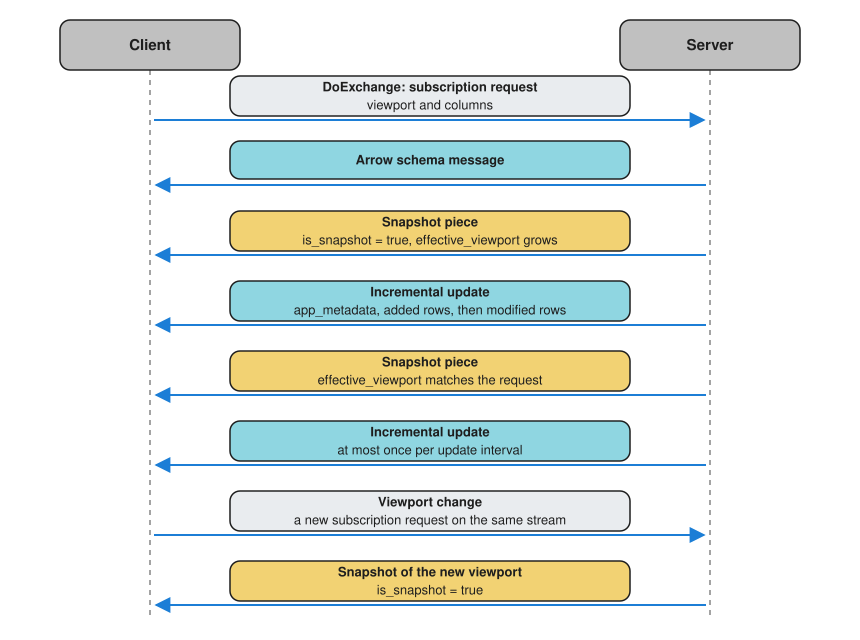

<div className="comment-title">

Bringing incremental table updates to your data backplane

</div>

The Deephaven team has long been fascinated with two related software problems:

1. How to best serve use cases driven by real-time data, within a general-purpose, table-oriented data system.

2. How to transport real-time table-oriented data over the wire efficiently, without paying to translate it between formats. This applies between nodes of such a system and between disparate systems.

The first challenge catalyzed the development of Deephaven's [incremental table update model](./table-update-model.md). Users have applied this design in a variety of contexts, from driving complex multimillion-dollar options market-making strategies to simulating the behavior of cryptographic networks. Deephaven's model, developed to address real-world use cases in production deployments, is a unique and empowering approach to building modern data-driven systems. Read [our introduction to Deephaven](./deephaven-overview.md) for a discussion of what users of Deephaven have accomplished under the incremental update model.

For the second, the philosophies and solutions provided by [gRPC](https://grpc.io/) and [Apache Arrow Flight](https://arrow.apache.org/docs/format/Flight.html) illuminated a compelling path forward.

The result is the Deephaven Core API: a set of gRPC services that clients in any gRPC-supported language can use to create, query, and subscribe to tables on a Deephaven server. This page walks through its building blocks, and how clients use them, in order:

- gRPC, Apache Arrow, and Arrow Flight.
- [Barrage](./what-is-barrage.md), Deephaven's extension that carries incremental updates over Flight.
- The services that make up the Core API.
- How an existing Flight client can use them.
- How the browser-based [JavaScript client](/core/client-api/javascript/) carries bidirectional streams, such as [Barrage](./what-is-barrage.md) subscriptions.

## gRPC: a high-performance universal RPC framework

[gRPC](https://grpc.io/) is a modern Remote Procedure Call (RPC) framework that is platform- and environment-agnostic. Open source communities have widely adopted gRPC. Developers define complex APIs using simple service definitions, from which gRPC generates client and server code in more than a dozen target languages, some supported officially and others by the community. Client and server implementations have the freedom to select the programming language that suits their use case best.

Services can choose from a variety of request-response communication patterns:

| RPC type                  | Client messages | Server messages |
| ------------------------- | --------------- | --------------- |
| Unary                     | 1               | 1               |
| Server streaming          | 1               | None or many    |
| Client streaming          | None or many    | 1               |
| Bidirectional streaming\* | None or many    | None or many    |

_\* There is no framework restriction on whether the client or server controls the conversation._

## Apache Arrow: a cross-language platform for analytics

[Apache Arrow](https://arrow.apache.org/) (Arrow) defines a language-independent columnar memory format for flat and hierarchical data. The in-memory format is optimized for analytics on modern hardware, including GPUs. Arrow is widely adopted, so examples and community support are easy to find.

## Apache Arrow Flight: an Arrow IPC framework

[Apache Arrow Flight](https://arrow.apache.org/docs/format/Flight.html) (Flight) provides an interprocess communication (IPC) model that is built around Arrow's in-memory model and communicates over gRPC. Flight organizes communication around streams of `FlightData` messages, each of which can carry an Arrow record batch (`RecordBatch`). Most Flight implementations intrinsically support zero-copy writes and zero-copy reads, removing unnecessary translation costs when shipping data from one server to another.

Flight defines the following RPCs:

- `Handshake(stream HandshakeRequest): stream HandshakeResponse`

  Authenticate with an optional, lightweight, implementation-specific stream.

- `ListFlights(Criteria): stream FlightInfo`

  Request a list of available Flight streams that match the given criteria.

- `GetFlightInfo(FlightDescriptor): FlightInfo`

  Request information about how the Flight can be consumed.

- `PollFlightInfo(FlightDescriptor): PollInfo`

  Start a query and poll for its progress, for long-running requests. Deephaven does not implement this RPC.

- `GetSchema(FlightDescriptor): SchemaResult`

  Get the schema of the columnar format, which describes the wire format of the `FlightData` body.

- `DoGet(Ticket): stream FlightData`

  Retrieve a single stream of `FlightData` for the referenced ticket. A ticket is an opaque identifier that names a dataset on the server.

- `DoPut(stream FlightData): stream PutResult`

  Upload a stream of `FlightData` to the server.

- `DoExchange(stream FlightData): stream FlightData`

  Open a bidirectional data channel with the server. This enables client and server to send and receive arbitrary Arrow data in a single logical stream. Typically, the client identifies the purpose of the conversation by attaching application-specific metadata to its initial request.

- `DoAction(Action): stream Result`

  Run an opaque request on the server and return its results, without defining a new gRPC method.

- `ListActions(): stream ActionType`

  List the actions this Flight server supports, so that application-specific clients can tell one server's capabilities from another's.

## Barrage: incremental updates over Flight

Flight is built to maximize throughput for structured data sent over IPC. Deephaven brings a rich toolset for processing real-time table operations, driven by incremental updates, and therefore requires a means to describe table changes. Flight does not natively have a mechanism to describe incrementally changing datasets. It does, however, allow API implementers to provide their own metadata to augment the built-in data transfer capabilities.

Deephaven uses application metadata to incorporate an update model alongside the native Arrow payloads. This extension is called [Barrage](./what-is-barrage.md), as an homage to all that we've inherited from the Arrow team's work.

[Barrage](./what-is-barrage.md) is designed to support two primary use cases:

1. The first use case targets server-to-server processing, where the client wants to subscribe to, and maintain, the entire state of the source table.
2. The second use case targets user-facing interactive applications, where the user only needs the data that fits on the screen. After all, there are physical limits that make scroll bars convenient.

### Introducing `BarrageUpdateMetadata`

> [!NOTE]
> This page does not provide comprehensive documentation or usage instructions. For more details, see the [Barrage documentation](/barrage/docs).

The primary metadata object that [Barrage](./what-is-barrage.md) uses to describe an incremental update is called `BarrageUpdateMetadata`. To carry incremental updates over Flight, it solves three sub-problems. The sections below name the fields for each and explain the last two in detail:

- **Incremental updates**: a transport-agnostic model of what changed in a table.
- **Transport framing**: a way to split large payloads into smaller messages that fit within gRPC message-size limits.
- **Data view framing**: a way to send interactive clients only the data a user can see.

#### Incremental updates

`BarrageUpdateMetadata` needs a transport-agnostic model of what changed in a table. These fields describe the added, removed, shifted, and modified rows:

```flatbuffer
added_rows: [byte];
removed_rows: [byte];
shift_data: [byte];
added_rows_included: [byte];
mod_column_nodes: [BarrageModColumnMetadata];
```

The details of this sub-problem, including [Deephaven's approach to incremental updates](./table-update-model.md), are out of scope for this page.

#### Transport framing

[Barrage](./what-is-barrage.md) splits large updates into smaller messages to stay within the message-size limits of gRPC implementations. Two of the fields listed under [Incremental updates](#incremental-updates), `added_rows_included` and `mod_column_nodes`, also tell the client how an update is split across messages.

Flight's [`DoGet`](#apache-arrow-flight-an-arrow-ipc-framework) and [`DoExchange`](#apache-arrow-flight-an-arrow-ipc-framework) RPCs return a stream of [`FlightData`](#apache-arrow-flight-an-arrow-ipc-framework) messages, so a server can split a large dataset into smaller pieces. Each `FlightData` message carries at most one Arrow message, usually a `RecordBatch`.

Flight's service definition gives the order of `RecordBatch`es no meaning, but an integration can define its own. A [Barrage](./what-is-barrage.md) subscription stream has this order:

- An Arrow schema message.
- One or more snapshots of the subscribed data.
- Incremental updates. While a large snapshot is still arriving in pieces, updates for rows the client already has can arrive between the pieces.
- A new snapshot whenever the client changes its subscription.

A single snapshot or update can span several `RecordBatch`es.



The server sends incremental updates no more often than the subscription's update interval, as described in [Barrage update batching](#barrage-update-batching).

[Barrage](./what-is-barrage.md) breaks each update payload into a sequence of `RecordBatch`es:

- The first `FlightData` message that carries a `RecordBatch` also carries the `BarrageUpdateMetadata`, wrapped in a `BarrageMessageWrapper`, in its `app_metadata` field.
- The server sends this message even when the update has no rows.
- A dictionary-encoded column sends each distinct value once, in a separate `DictionaryBatch` message, and its rows refer to those values. `DictionaryBatch` messages carry no [Barrage](./what-is-barrage.md) metadata, and they can come before any `RecordBatch`.
- The client learns how many added rows to expect from `added_rows_included` and how many modified rows to expect from `mod_column_nodes`. If `added_rows_included` is absent, every row in `added_rows` is included.
- The server sends every added-row `RecordBatch` before any modified-row `RecordBatch`.
- The client keeps reading `RecordBatch`es until it has received all of those rows.
- Either row count may be zero depending on what the server is trying to communicate.

#### Data view framing

For the user-level view of viewports, see [Viewports](./what-is-barrage.md#viewports). This section covers the wire-level fields.

Interactive clients only need the rows and columns a user can see, and need to know when the server has applied a change to that view. These `BarrageUpdateMetadata` fields support that:

```flatbuffer
is_snapshot: bool;
effective_viewport: [byte];
effective_reverse_viewport: bool;
effective_column_set: [byte];
table_size: long;
```

[Barrage](./what-is-barrage.md) treats the viewport as a first-class concept. A viewport is a window over the source table: a set of row-position ranges and a set of columns. It matches the data the user can see and interact with. When `effective_reverse_viewport` is `true`, the row positions count back from the end of the table.

Because a viewport client receives only part of the table, each update also carries `table_size`, the current number of rows in the source table.

Viewport changes are asynchronous, which has two consequences:

- The client keeps the state it subscribed to, so the server sends only changes. The client therefore needs to know when the server starts honoring a new viewport.
- A client can change its viewport again before the server responds, for example while the user is still scrolling. The server honors only the most recently requested viewport and may skip earlier requests it has not yet acknowledged. It has switched to that viewport once a snapshot's `effective_viewport` matches the requested one.

When a client starts or changes a subscription, the server responds with one or more snapshots:

- Each snapshot payload has `is_snapshot` set to `true`.
- By default the server sends a large snapshot in pieces over several [update cycles](./periodic-update-graph-configuration.md). For a viewport subscription, each piece widens `effective_viewport` until it matches the requested viewport. To tune this, see [Control subscription snapshot size](../how-to-guides/performance/barrage-performance.md#control-subscription-snapshot-size).
- Only snapshot payloads include `effective_viewport` and `effective_column_set`, which tell the client which data the server now tracks.
- The server sends a snapshot even when it has no new Arrow data to send, for example when the viewport shrinks.
- Unless the change reverses the viewport's direction or adds columns, the server does not resend data that the old and new viewports share.

### Barrage update batching

[Barrage](./what-is-barrage.md) also controls how often a subscription receives updates. For the user-level view, see [Update intervals and batching](./what-is-barrage.md#update-intervals-and-batching).

Every subscription, whether it covers a full table or a viewport, receives updates no more often than its update interval. Changes that arrive sooner are held and sent together in one message, much as the [update graph](./periodic-update-graph-configuration.md) batches table changes into cycles.

Batching trades latency for throughput. Within one process, many small updates are cheap. Over a network, every message costs far more, because machine-to-machine communication is slower than CPU-to-RAM communication. Fewer, combined messages perform better there.

When one message combines several [update cycles](./periodic-update-graph-configuration.md), two fields identify them:

- `first_seq`: the first upstream [update cycle](./periodic-update-graph-configuration.md) in the message.
- `last_seq`: the last upstream [update cycle](./periodic-update-graph-configuration.md) in the message.

These fields are informational. Few applications need them, but they are useful when debugging a client implementation.

The server sets a default interval, and each subscription can request its own. To tune it, see [Update interval](../how-to-guides/performance/barrage-performance.md#update-interval).

## Enter the Deephaven Core API

The Deephaven Core API includes the following gRPC services:

- [Arrow Flight](#apache-arrow-flight-an-arrow-ipc-framework) Service — high-performance data transport based on Arrow data.
- [Table](#the-table-service) Service — manipulation of tables through an API that mirrors Deephaven's internal compute API.
- Session Service — management of a client's session and resources.
- Console Service — control of a read-eval-print loop (REPL), such as a Python or Groovy console, from a client.
- Application Service — discovery of the objects of all types that the server makes available, such as REPL variables and [Application Mode](../how-to-guides/application-mode.md) fields. It is similar to [`ListFlights`](#apache-arrow-flight-an-arrow-ipc-framework) but not limited to tables.
- Object Service — communication with server-side objects defined by [plugins](../how-to-guides/install-use-plugins.md), such as widgets.
- Hierarchical Table Service — creation and viewing of [rollup tables](../how-to-guides/rollup-table.md) and [tree tables](../how-to-guides/tree-table.md).
- Partitioned Table Service — creation and querying of [partitioned tables](../how-to-guides/partitioned-tables.md).
- Input Table Service — addition and deletion of rows in [input tables](../how-to-guides/input-tables.md).
- Config Service — retrieval of authentication and configuration constants from the server.
- Storage Service — management of files in the server's shared storage, such as notebooks.
- Browser Flight Service — Flight's streaming RPCs adapted for browsers that cannot send client streams. See [Bidirectional streams from the browser](#bidirectional-streams-from-the-browser).

The [Flight](#apache-arrow-flight-an-arrow-ipc-framework) and [Table](#the-table-service) services are the foundational elements of the Deephaven Core API.

## The Table Service

The Deephaven Core API Table Service lets you build an entire directed acyclic graph (DAG) of requests in a single batch gRPC call to the server. Being able to define your application's logic once and ship it to the server is extremely powerful.

Client or server implementations may refactor the DAG payload for optimization or canonicalization purposes.

Flight's [`DoAction`](#apache-arrow-flight-an-arrow-ipc-framework) could carry a command that tells the server to [sort](../reference/table-operations/sort/sort.md) table `X` by column `Y` and [filter](../reference/table-operations/filter/where.md) column `A` by value `B`. However, the Deephaven team decided that [`DoAction`](#apache-arrow-flight-an-arrow-ipc-framework) doesn't give enough structure to the queries that Deephaven supports.

Deephaven's web user interface relies on the Table Service. When you [sort](../reference/table-operations/sort/sort.md), [filter](../reference/table-operations/filter/where.md), or [add columns](../reference/table-operations/select/update-view.md) in the UI, it sends those operations to the server in a Table Service batch request. This offloads heavy work from your machine, while maintaining the illusion that your data is right there, at your fingertips.

The Table Service complements the Flight Service through Flight tickets. As described under [`DoGet`](#apache-arrow-flight-an-arrow-ipc-framework), a ticket names an object on the server, such as a table, rather than carrying its data.

- Flight tickets identify an operation's upstream tables and its result table.
- Within a batch request, an operation can instead refer to an earlier operation in the same batch by its position, so intermediate results need no ticket.
- Later requests, including requests to the Flight Service, can refer to those tickets.
- If an upstream operation has not completed, the server waits for it before running the operation that depends on it.
- When the user is done with a result, they release its ticket.
- Releasing a ticket before its operation finishes cancels that operation and fails any queued operation that depends on it. If other operations still need a ticket, wait until its operation finishes before releasing it.
- The server releases intermediate tables created within a single batch request once nothing depends on them.

[`TicketResolver`](/core/javadoc/io/deephaven/server/session/TicketResolver.html) adds yet more value. It is the server-side Java interface that turns a ticket into the object it names. To serve data from another system through the Core API, you can write your own resolver and add it to the server's classpath. For example, a resolver could fill in a SQL template, fetch the results from a SQL server, and export them as a static Deephaven table.

## Use the Core API from a Flight client

An existing Flight client can work with a Deephaven server directly. Flight clients authenticate with Flight's standard [`Handshake`](#apache-arrow-flight-an-arrow-ipc-framework) or with authentication headers. To manage their Deephaven session, they can use the Session Service ([`session.proto`](https://github.com/deephaven/deephaven-core/blob/main/proto/proto-backplane-grpc/src/main/proto/deephaven_core/proto/session.proto)). Once connected:

- [`ListFlights`](#apache-arrow-flight-an-arrow-ipc-framework) describes tables bound to REPL variables and tables exported through [Application Mode](../how-to-guides/application-mode.md). Deephaven does not support criteria expressions, so send empty `Criteria`.
- [`DoGet`](#apache-arrow-flight-an-arrow-ipc-framework) fetches a snapshot of the entire table, converting any column with no Arrow mapping to strings.
- [`DoPut`](#apache-arrow-flight-an-arrow-ipc-framework) uploads your own static content.
- [`DoExchange`](#apache-arrow-flight-an-arrow-ipc-framework) subscribes to incremental updates, or takes a one-time snapshot of selected rows and columns.

[Flight SQL](../how-to-guides/flight-sql.md) clients can also query the server's tables with SQL.

[`DoPut`](#apache-arrow-flight-an-arrow-ipc-framework) maps each uploaded Arrow column to a Deephaven column type based on its Arrow type. To request a specific Java type, set the optional Arrow field metadata key `deephaven:type`.

Deephaven does not support every Arrow type. For the supported types and their Deephaven equivalents, see [Arrow Flight and Deephaven](../how-to-guides/data-import-export/arrow-flight.md). For the full mapping in source, see [`BarrageUtil`](https://github.com/deephaven/deephaven-core/blob/main/extensions/barrage/src/main/java/io/deephaven/extensions/barrage/util/BarrageUtil.java).

[`DoExchange`](#apache-arrow-flight-an-arrow-ipc-framework) requires that you understand our [update model](./table-update-model.md) and the [`BarrageUpdateMetadata`](#introducing-barrageupdatemetadata) that [Barrage](./what-is-barrage.md) attaches to each update. If this interests you, the [Barrage documentation](/barrage/docs) is the best place to dip your feet in.

To suggest improvements to Deephaven's Flight and [Barrage](./what-is-barrage.md) integration, [start a discussion](https://github.com/deephaven/deephaven-core/discussions) on GitHub.

## Bidirectional streams from the browser

You may have noticed that even Deephaven's web user interface processes incremental updates. It is built on the [Deephaven JavaScript client](/core/client-api/javascript/), a gRPC client. Like other [Barrage](./what-is-barrage.md) clients, it subscribes to incremental updates through [`DoExchange`](#apache-arrow-flight-an-arrow-ipc-framework) and receives [`FlightData`](#apache-arrow-flight-an-arrow-ipc-framework) payloads.

How it carries bidirectional streams such as [`DoExchange`](#apache-arrow-flight-an-arrow-ipc-framework) depends on the transport:

- Over HTTPS, the client uses the browser's `fetch` API over HTTP/2. This transport receives server-streamed responses but cannot send a client stream, so Deephaven simulates one:
  - It splits each bidirectional stream into one server-streaming request followed by a series of unary requests.
  - The client attaches HTTP/2 headers that identify the simulated stream, each message's sequence number, and whether the client has finished sending.
  - The server puts the unary requests in order and passes them to its existing bidirectional-streaming implementation, such as the one behind [`DoExchange`](#apache-arrow-flight-an-arrow-ipc-framework).
- Over plain HTTP, the client uses websockets, which carry bidirectional streams directly.

To use websockets over HTTPS as well, set the `useWebsockets` connection option to `true`. A custom `transportFactory` connection option overrides both defaults.

## Related documentation

- [Deephaven Overview](./deephaven-overview.md)
- [Table update model](./table-update-model.md)
- [What is Barrage?](./what-is-barrage.md)
- [Servers and clients](./client-server-model.md)
- [Periodic update graph configuration](./periodic-update-graph-configuration.md)
- [How to run scripts before launch with Application Mode](../how-to-guides/application-mode.md)
- [Install and use plugins](../how-to-guides/install-use-plugins.md)
- [Rollup tables](../how-to-guides/rollup-table.md)
- [Tree tables](../how-to-guides/tree-table.md)
- [Partitioned tables](../how-to-guides/partitioned-tables.md)
- [Input tables](../how-to-guides/input-tables.md)
- [Barrage performance](../how-to-guides/performance/barrage-performance.md)
- [Arrow Flight and Deephaven](../how-to-guides/data-import-export/arrow-flight.md)
- [Connecting to a Deephaven Flight SQL server](../how-to-guides/flight-sql.md)
- [Use the JS API](../how-to-guides/use-jsapi.md)
- [`sort`](../reference/table-operations/sort/sort.md)
- [`where`](../reference/table-operations/filter/where.md)
- [`updateView`](../reference/table-operations/select/update-view.md)
- [`TicketResolver` Javadoc](/core/javadoc/io/deephaven/server/session/TicketResolver.html)
- [Deephaven Barrage](/barrage/docs)
- [Python client](/core/client-api/python/)
- [Java client](/core/javadoc/)
- [C++ client](/core/client-api/cpp/)
- [JavaScript client](/core/client-api/javascript/)
- [R client](/core/client-api/r/)
- [gRPC service definitions](https://github.com/deephaven/deephaven-core/tree/main/proto/proto-backplane-grpc/src/main/proto/deephaven_core/proto)
