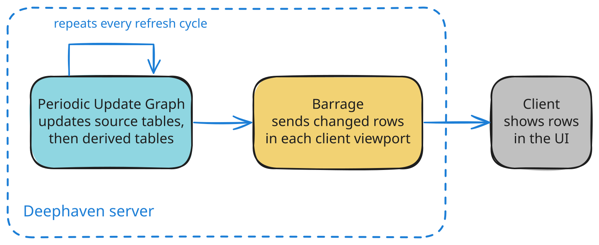
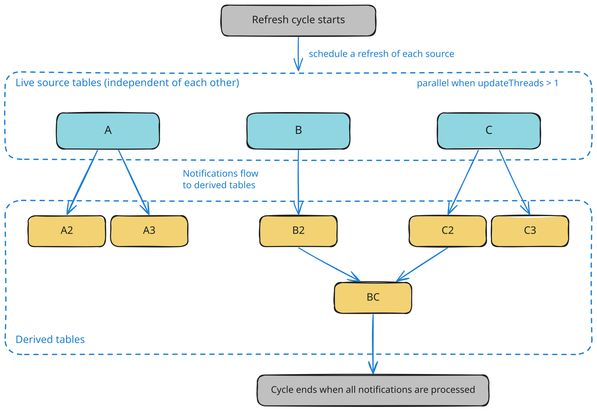
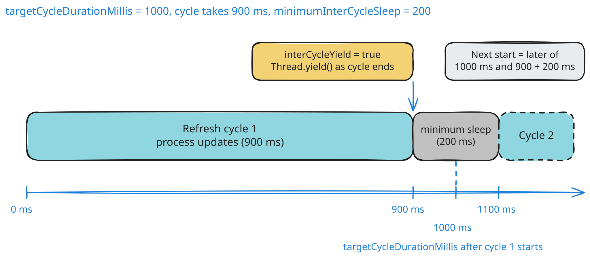

This guide discusses how to control the update frequency of your Deephaven tables, which allows you to fine-tune your application's latency. It also covers the thread pool that initializes new table operations.

There are two underlying processes when updating [streaming tables](./table-types.md) in Deephaven:

1. When new data is generated or acquired, the Periodic Update Graph (PUG) first manages the process of updating the source tables and the derived tables with the new data. Each pass of this process is a refresh cycle. A source table receives data from outside the server, or generates its rows inside the server. For example, `TimeTable` generates rows from the server clock. A derived table is computed from one or more other tables. At this point, data updates are available within the server process.
2. Once a table has been updated during the PUG refresh cycle, Barrage sends the changed rows to each subscribed client. A web UI client displays the changed rows in its viewport, the visible portion of the table. Other clients, such as those that subscribe to a full table, receive the same changes without a viewport.

This page covers the first process, which the PUG controls. [What is Barrage?](./what-is-barrage.md) explains how the server sends the results to clients.



## Periodic Update Graph

The Periodic Update Graph is an [`UpdateGraph`](/core/javadoc/io/deephaven/engine/updategraph/UpdateGraph.html), the component that controls how often data is refreshed on the server. At the beginning of a cycle, the PUG schedules a refresh of each source table. With more than one update thread, those refreshes can run on the update threads rather than only on the PUG thread. When a source table has new data, it enqueues a notification of the changes for all registered [listeners](../how-to-guides/table-listeners-groovy.md). Listeners then do the following:

- Generate derived tables and send further notifications to their children.
- Enqueue table updates for [Barrage](./what-is-barrage.md), which sends them to clients in a separate step.
- Perform custom user logic and other incremental processing tasks.

The PUG executes independent notifications in parallel, starting with the source tables:

- Deephaven optimizes each operation for high single-threaded performance.
- Distinct operations run on multiple threads at once.
- The refresh cycle completes after all notifications are processed.

Parallel execution of update notifications requires more than one update thread. Set the thread count with [`updateThreads`](#updatethreads).

An illustration of the process is below:



In the diagram above, the PUG refreshes the live source tables `A`, `B`, and `C` first. Their changes flow into the derived tables `A2`, `A3`, `B2`, `C2`, `C3`, and `BC`, which update after the sources.

The Periodic Update Graph has four user-configurable properties, listed with their defaults in the [Configuration](#configuration) section.

In the normal case, the next refresh cycle starts at the later of two times. Scheduling and lock delays can shift these times:

- `targetCycleDurationMillis` after the previous cycle started. The timer starts before the cycle acquires the exclusive lock, so lock waits can shift when the logical cycle starts.
- `minimumInterCycleSleep` after the previous cycle completed.

The following timeline shows an example with a 900 ms cycle and a 200 ms minimum sleep:



## Manually triggering a refresh

By default, the PUG starts each cycle on a timer set by [`targetCycleDurationMillis`](#targetcycledurationmillis) and [`minimumInterCycleSleep`](#minimumintercyclesleep). Trigger a refresh immediately, instead of waiting for the next scheduled tick, when a table must reflect a change at once. A common case is an in-memory [input table](../how-to-guides/input-tables.md). It requests a refresh when you add or change rows. Another case is a custom in-process source that you update from your own code.

You can request an immediate refresh by calling [`requestRefresh`](/core/javadoc/io/deephaven/engine/updategraph/impl/PeriodicUpdateGraph.html#requestRefresh()) on the [`UpdateGraph`](/core/javadoc/io/deephaven/engine/updategraph/UpdateGraph.html):

```groovy
import io.deephaven.engine.updategraph.impl.PeriodicUpdateGraph
PeriodicUpdateGraph.getInstance("DEFAULT").requestRefresh()
```

The [`requestRefresh`](/core/javadoc/io/deephaven/engine/updategraph/impl/PeriodicUpdateGraph.html#requestRefresh()) call asks the PUG to begin the next cycle as soon as practicable. For that cycle, the request skips the wait for `targetCycleDurationMillis` and `minimumInterCycleSleep`. Updates are still processed in the usual order.

## Operation initialization thread pool

When you create some table operations, part of their initial computation can run on the operation initialization thread pool instead of the thread that created the operation. Operations that do this include:

- [filter](../reference/table-operations/filter/where.md)
- [sort](../reference/table-operations/sort/sort.md)
- [`select`](../reference/table-operations/select/select.md)/[`update`](../reference/table-operations/select/update.md) when the query has columns that can be computed in parallel

The operation initialization thread pool has one user-configurable property, described in [its section](#operationinitializationthreadpoolthreads) below.

## Configuration

| Property                                        | Default | Description                                                                                  |
| ----------------------------------------------- | ------- | -------------------------------------------------------------------------------------------- |
| `PeriodicUpdateGraph.updateThreads`             | `-1`    | Threads the refresh cycle uses to process update notifications.                              |
| `PeriodicUpdateGraph.targetCycleDurationMillis` | `1000`  | Target time in milliseconds between the starts of consecutive refresh cycles.                |
| `PeriodicUpdateGraph.minimumInterCycleSleep`    | `0`     | Minimum time in milliseconds to wait between the end of one cycle and the start of the next. |
| `PeriodicUpdateGraph.interCycleYield`           | `false` | Whether the refresh thread calls `Thread.yield` after each cycle.                            |
| `OperationInitializationThreadPool.threads`     | `-1`    | Threads the operation initialization thread pool uses.                                       |

### `updateThreads`

The `PeriodicUpdateGraph.updateThreads` property sets how many threads the refresh cycle uses to process update notifications. The default value of `-1` uses all available processors for concurrent work. Set a positive value to use exactly that many threads.

[Partitioned tables](../how-to-guides/partitioned-tables.md) give the engine more independent work to run in parallel. Create one with [`partitionBy`](../reference/table-operations/group-and-aggregate/partitionBy.md).

### `targetCycleDurationMillis`

The `PeriodicUpdateGraph.targetCycleDurationMillis` property sets the target time in milliseconds between the start of one PUG refresh cycle and the start of the next. The default is 1000 milliseconds (one second).

Setting this to 500 milliseconds asks the PUG to start a refresh cycle every 500 milliseconds instead of every 1000 milliseconds. That frequency holds only while each cycle finishes within 500 milliseconds.

The value set for this property does not guarantee the actual time for the cycle to complete. In the normal scheduling case, a cycle that finishes early waits until the full target duration has elapsed before the next cycle starts. A `requestRefresh` call or an input-table edit can start the next cycle sooner. A cycle that takes longer than the target falls behind it. The next cycle starts as soon as this one completes, subject to the minimum sleep.

A variety of conditions can cause the actual refresh cycle to take longer than the target cycle duration, including:

- The actual time needed for incremental update processing from refreshed tables may be longer than anticipated.
- The refresh thread must acquire the [`UpdateGraph`](/core/javadoc/io/deephaven/engine/updategraph/UpdateGraph.html)'s exclusive lock to start a cycle, so it waits while other threads hold the shared lock (for example, while initializing a query, or when a snapshot falls back to the shared lock after failing to complete optimistically). See [Multithreading: Synchronization, locks, and snapshots](./query-engine/engine-locking.md).
- If the server is busy, the refresh thread may not be scheduled.

### `minimumInterCycleSleep`

The `PeriodicUpdateGraph.minimumInterCycleSleep` property sets the minimum amount of time in milliseconds to wait before starting another refresh cycle after the current cycle has completed.

Consider a situation where `targetCycleDurationMillis` keeps its default value of 1000 ms. The actual time to complete a particular refresh cycle is 900 ms. If you set `minimumInterCycleSleep` to 0, the next refresh cycle starts 100 ms later. If you set `minimumInterCycleSleep` to 200 ms, the next cycle starts 1100 ms after the current cycle starts. That total is the 900 ms cycle time plus the 200 ms sleep time.

### `interCycleYield`

The `PeriodicUpdateGraph.interCycleYield` property controls whether the refresh thread calls `Thread.yield` after each cycle, which hints to the scheduler that other threads may run. Yielding does not bypass the waits set by `targetCycleDurationMillis` and `minimumInterCycleSleep`, and it can delay the next cycle when a minimum sleep is set.

### `OperationInitializationThreadPool.threads`

The `OperationInitializationThreadPool.threads` property allows multithreading during new operation initiation. The default value of `-1` uses all available processors for concurrent initiation work.

## Structuring data for parallelism

Divide work along natural boundaries in your data, and structure the data for efficient parallel processing. For a deeper dive, see [parallelism with partitioned tables](../how-to-guides/partitioned-tables.md#parallelization).

## Related documentation

- [What is Barrage?](./what-is-barrage.md)
- [Multithreading: Synchronization, locks, and snapshots](./query-engine/engine-locking.md)
- [Parallelizing queries](./query-engine/parallelization.md)
- [Table listeners](../how-to-guides/table-listeners-groovy.md)
- [Input tables](../how-to-guides/input-tables.md)
- [Partitioned tables](../how-to-guides/partitioned-tables.md)
- [`partitionBy`](../reference/table-operations/group-and-aggregate/partitionBy.md)
- [`where`](../reference/table-operations/filter/where.md)
- [`sort`](../reference/table-operations/sort/sort.md)
- [`select`](../reference/table-operations/select/select.md)
- [`update`](../reference/table-operations/select/update.md)
- [`snapshot`](../reference/table-operations/snapshot/snapshot.md)
- [`PeriodicUpdateGraph` Javadoc](/core/javadoc/io/deephaven/engine/updategraph/impl/PeriodicUpdateGraph.html)
- [`requestRefresh` Javadoc](/core/javadoc/io/deephaven/engine/updategraph/impl/PeriodicUpdateGraph.html#requestRefresh())
