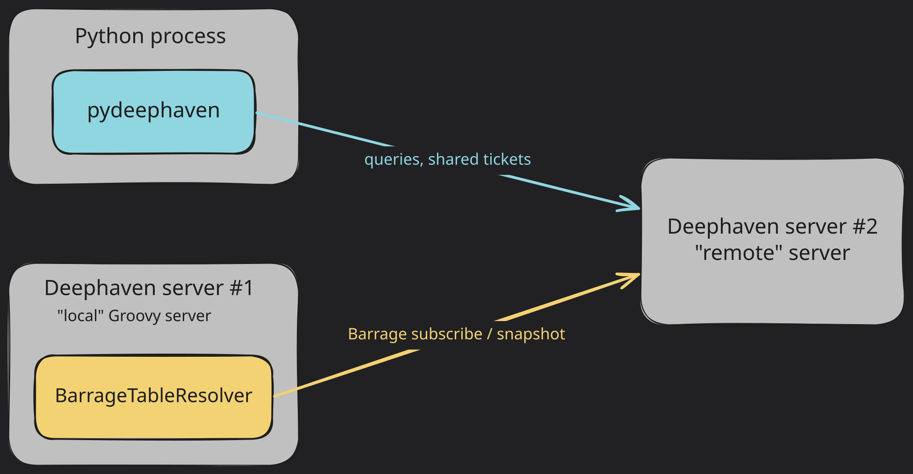

The [Deephaven Python client](/core/client-api/python/) can create new tables and retrieve references to tables on a remote Deephaven server. These references are not true Deephaven tables, so you can't use them in a typical Deephaven server query.

To get true Deephaven tables from a remote server into your Groovy server, you _capture_ them. Capturing a table means either subscribing to its real-time updates or taking a static snapshot of its data. You capture tables over [Barrage](../conceptual/what-is-barrage.md) using shared tickets, which are identifiers that clients and servers can both use to address the same Deephaven table.

Shared tickets let you capture tables that you create or access with the Python client, whether they are static or [ticking](../conceptual/table-types.md). To pull a table that already exists on the remote server by name, you can use a URI instead. See the [URI guide](./use-uris.md).

## Setup

This guide covers capturing tables from a "remote" Deephaven server to a "local" Deephaven server that runs Groovy. The servers do not need to run on different hosts, but the terminology helps distinguish the two.

The workflow uses two connections to the remote server:

- The Deephaven Python client, [`pydeephaven`](/core/client-api/python/), runs in a separate Python process. You use it to run queries on the remote server and to publish tables to shared tickets.
- The local Groovy server uses [`BarrageTableResolver`](/core/javadoc/io/deephaven/server/uri/BarrageTableResolver.html) to open a Barrage connection that retrieves tables from the remote server.



> [!IMPORTANT]
> [`BarrageTableResolver`](/core/javadoc/io/deephaven/server/uri/BarrageTableResolver.html) does not support authentication, so the remote server must accept [anonymous authentication](./authentication/auth-anon.md). This is the same limitation that applies to URIs, tracked in [deephaven-core#3421](https://github.com/deephaven/deephaven-core/issues/3421).

You need an installation of [`pydeephaven`](/core/client-api/python/) in the Python environment that runs the client:

```bash
pip install pydeephaven
```

To learn about the Deephaven Python client, check out the [Python client Quickstart](/core/docs/getting-started/pyclient-quickstart/).

## Connect the Python client to the remote Deephaven server

The Deephaven Python client creates and maintains a connection to the remote Deephaven server through a [`Session`](/core/client-api/python/code/pydeephaven.session.html#pydeephaven.session.Session). You also use this object to create tables on the remote server. To connect, you supply the remote server's host name or IP address, port, and authentication details.

If you omit any of these, the [`Session`](/core/client-api/python/code/pydeephaven.session.html#pydeephaven.session.Session) uses a default:

- Host: the `DH_HOST` environment variable, or `localhost` if that variable isn't set.
- Port: the `DH_PORT` environment variable, or `10000` if that variable isn't set.
- Authentication: anonymous authentication.

The local server already uses the default port, `10000`, so suppose that the "remote" Deephaven server is running locally on port `9999` with [anonymous authentication](./authentication/auth-anon.md). Run the following in the Python client:

```python skip-test
from pydeephaven import Session

# with DH_HOST unset, this is short for Session(host="localhost", port=9999, auth_type="Anonymous")
client_session = Session(port=9999)
```

See the [`Session`](/core/client-api/python/code/pydeephaven.session.html#pydeephaven.session.Session) API documentation for more configuration options.

## Retrieve table references using the client

Once you've established a client connection to the remote Deephaven server, you can use the [`Session`](/core/client-api/python/code/pydeephaven.session.html#pydeephaven.session.Session) instance to create new tables on the server or retrieve references to existing tables.

As an example, you can create a new static table on the server using [`empty_table`](/core/client-api/python/code/pydeephaven.session.html#pydeephaven.session.Session.empty_table):

```python skip-test
table_ref = client_session.empty_table(10).update(["X = i", "Y = X / 2"])
```

`table_ref` is not a Deephaven table itself, but a _reference_ to a Deephaven table on the server. See this [overview of the Python client design](/core/docs/getting-started/pyclient-quickstart/#2-a-brief-overview-of-the-python-client-design) for more information on table references.

Similarly, you can use [`time_table`](/core/client-api/python/code/pydeephaven.session.html#pydeephaven.session.Session.time_table) to create a ticking table on the server:

```python skip-test
table_ref = client_session.time_table("PT1s").update(["X = i", "Y = X / 2"])
```

If a table already exists on the remote server, you can retrieve a reference to it with the [`open_table`](/core/client-api/python/code/pydeephaven.session.html#pydeephaven.session.Session.open_table) method:

```python skip-test
table_ref = client_session.open_table("table_on_server")
```

## Publish the table to a shared ticket

Once you have a reference to a table on the server, you can publish it with a shared ticket. In the Python client, create a shared ticket with the [`SharedTicket`](/core/client-api/python/code/pydeephaven.ticket.html#pydeephaven.ticket.SharedTicket) class. Then publish the table to the ticket with [`publish_table`](/core/client-api/python/code/pydeephaven.session.html#pydeephaven.session.Session.publish_table).

The Groovy server needs the ticket's bytes, so this example gives the ticket a known name instead of generating a random one with [`SharedTicket.random_ticket`](/core/client-api/python/code/pydeephaven.ticket.html#pydeephaven.ticket.SharedTicket.random_ticket). The name must meet two requirements:

- Its bytes start with `h`, which marks a shared ticket. [`SharedTicket`](/core/client-api/python/code/pydeephaven.ticket.html#pydeephaven.ticket.SharedTicket) raises an error for any other prefix.
- It isn't already in use on the remote server.

```python skip-test
from pydeephaven.ticket import SharedTicket

ticket = SharedTicket(b"hcapture_example")
client_session.publish_table(ticket, table_ref)
```

The ticket stays valid only while `client_session` is open and the published table is alive. Keep the Python client running, and keep a reference to `table_ref` without closing it.

## Capture the table on the local Groovy server

On the local Groovy server, use [`BarrageTableResolver`](/core/javadoc/io/deephaven/server/uri/BarrageTableResolver.html) to capture the table published to the ticket. You can capture it in two ways.

Use **subscribe** when:

- You need real-time updates as the source table changes.
- You're building a live dashboard or monitoring system.
- The source table is ticking (updating periodically).

Use **snapshot** when:

- You need a one-time, static copy of the data.
- The source table is static and won't change.
- You want to capture a point-in-time state for analysis.
- You need to reduce ongoing resource consumption.

To capture it:

1. Write the remote server's address as a target URI. Use the `dh+plain` scheme for a server without TLS, or `dh` for a server with TLS.
2. Build a [`TableSpec`](/core/javadoc/io/deephaven/qst/table/TableSpec.html) from the ticket bytes you published in the Python client (`hcapture_example`).
3. Call [`BarrageTableResolver.get`](/core/javadoc/io/deephaven/server/uri/BarrageTableResolver.html#get()) to obtain the server's resolver.
4. Pass the target URI and the [`TableSpec`](/core/javadoc/io/deephaven/qst/table/TableSpec.html) to the resolver's [`subscribe`](/core/javadoc/io/deephaven/server/uri/BarrageTableResolver.html#subscribe(java.lang.String,io.deephaven.qst.table.TableSpec)) or [`snapshot`](/core/javadoc/io/deephaven/server/uri/BarrageTableResolver.html#snapshot(java.lang.String,io.deephaven.qst.table.TableSpec)) method. Both return a [`Future`](https://docs.oracle.com/javase/8/docs/api/java/util/concurrent/Future.html).
5. Call [`Future.get`](https://docs.oracle.com/javase/8/docs/api/java/util/concurrent/Future.html#get--) on the result to wait for the table.

The following example subscribes to the ticket and creates a local table that updates in real time when the remote table changes:

```groovy skip-test
import io.deephaven.qst.table.TableSpec
import io.deephaven.server.uri.BarrageTableResolver

remoteTarget = "dh+plain://localhost:9999"
ticketSpec = TableSpec.ticket("hcapture_example".getBytes("UTF-8"))

localTStreaming = BarrageTableResolver.get().subscribe(remoteTarget, ticketSpec).get()
```

Alternatively, take a static snapshot:

```groovy skip-test
localTStatic = BarrageTableResolver.get().snapshot(remoteTarget, ticketSpec).get()
```

You now have `localTStreaming` and `localTStatic`, which are real Deephaven tables on the local Groovy server. Unlike `table_ref` in the Python client, they aren't references, so you can use them in any Deephaven query.

## Manage subscriptions

This section covers what an active subscription costs, how the local server reuses its Barrage connection, how to recover from connection problems, and how to keep large subscriptions small.

### Subscription resource usage

Each active subscription consumes resources on both the remote server and the local (subscribing) server:

| Resource | Remote server impact                             | Local server impact                               |
| -------- | ------------------------------------------------ | ------------------------------------------------- |
| Memory   | Maintains subscriber state and pending updates   | Stores table data and applies incremental updates |
| CPU      | Aggregates and serializes updates per subscriber | Deserializes and processes incoming updates       |
| Network  | Sends periodic update batches to each subscriber | Receives and buffers incoming data                |

For tables with frequent updates or many subscribers, these costs can add up. Monitor subscription health using the [Barrage performance tables](./performance/barrage-performance.md).

### Barrage connections from the local server

[`BarrageTableResolver`](/core/javadoc/io/deephaven/server/uri/BarrageTableResolver.html) opens one Barrage connection per target URI and reuses it for every later subscription and snapshot to that same target URI. `BarrageTableResolver` has no method to close that connection, so this workflow has no close step.

### Handle connection issues

Network interruptions can break Barrage subscriptions. Consider these patterns for production applications:

- **Failed subscription**: Subscribe to the ticket again. The new subscription reuses the local server's existing Barrage connection to the remote server.
- **Failed connection**: [`BarrageTableResolver`](/core/javadoc/io/deephaven/server/uri/BarrageTableResolver.html) can't replace a Barrage connection that has failed, for example because the remote server restarted. Restart the local server to open a new connection.
- **Ticket lifetime**: If the published table or `client_session` has gone away, re-publish before resubscribing. See [Publish the table to a shared ticket](#publish-the-table-to-a-shared-ticket).
- **Authentication expiry**: The remote server can accept other authentication methods alongside anonymous authentication. If the Python client connects with one of them, make sure its tokens or credentials stay valid for as long as the published table needs to stay available.

### Memory considerations for large tables

When subscribing to large ticking tables:

- **Initial snapshot size**: A subscription starts with a snapshot of the whole table. For very large tables, this can consume significant memory. By default, the server breaks large snapshots into chunks. See [snapshot size control](./performance/barrage-performance.md#control-subscription-snapshot-size).
- **Incremental updates**: After the initial snapshot, the remote server sends only changed rows. These updates are typically much smaller than the full table.
- **Server-side filtering**: If you only need a subset of the data, consider filtering the table on the remote server before subscribing. This reduces both network and memory usage.

The Python client is what publishes tickets to the remote server, so do the filtering there. Filter the table and publish the result to a new ticket:

```python skip-test
# Filter on the remote server before publishing
filtered_ref = client_session.open_table("large_table").where("Region = `EAST`")
filtered_ticket = SharedTicket(b"hcapture_example_filtered")
client_session.publish_table(filtered_ticket, filtered_ref)
```

Then subscribe to the new ticket from the local Groovy server:

```groovy skip-test
// The subscriber now receives only the filtered data
filteredSpec = TableSpec.ticket("hcapture_example_filtered".getBytes("UTF-8"))
localTFiltered = BarrageTableResolver.get().subscribe(remoteTarget, filteredSpec).get()
```

## Related documentation

- [Python client Quickstart](/core/docs/getting-started/pyclient-quickstart/)
- [What is Barrage?](../conceptual/what-is-barrage.md)
- [Share tables with URIs](./use-uris.md)
- [Anonymous authentication](./authentication/auth-anon.md)
- [`BarrageTableResolver` Javadoc](/core/javadoc/io/deephaven/server/uri/BarrageTableResolver.html)
