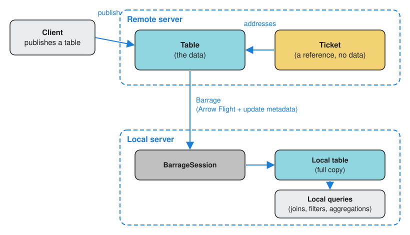

Barrage is Deephaven's streaming data protocol for efficient, real-time table transport between servers and clients. Barrage extends [Apache Arrow Flight](https://arrow.apache.org/docs/format/Flight.html) to support Deephaven's [incremental update model](./table-update-model.md), so subscribers receive only the data that has changed rather than the entire table on every update.

## Why Barrage?

Two common ways to move real-time data between a server and a client have limitations:

- **Polling**: Repeatedly fetching entire tables wastes bandwidth and CPU cycles, especially for large tables with small changes.
- **Arrow Flight alone**: [Apache Arrow Flight](../how-to-guides/data-import-export/arrow-flight.md) provides efficient data transport, but lacks native support for incrementally updating datasets. See [Barrage vs. Arrow Flight](#barrage-vs-arrow-flight) for a feature-by-feature comparison.

Barrage solves these problems by:

- Streaming only the rows that have been added, removed, or modified.
- Supporting viewports so clients can subscribe to just the visible portion of a table.
- Batching updates to balance latency against network efficiency.

## When to use Barrage

The following table matches common use cases to the Barrage feature that serves each one. [Key concepts](#key-concepts) explains each feature.

| Use case                                                                        | Barrage feature                                                                                                                                         |
| ------------------------------------------------------------------------------- | ------------------------------------------------------------------------------------------------------------------------------------------------------- |
| **Real-time dashboards**: Display live-updating tables in a UI                  | [Subscribe](#subscriptions-vs-snapshots) to streaming updates                                                                                           |
| **Server-to-server data sharing**: Move tables between Deephaven instances      | [Subscribe or snapshot](#subscriptions-vs-snapshots) via [shared tickets](#shared-tickets)                                                              |
| **Point-in-time analysis**: Work with a fixed copy of a table's current state   | [Snapshot](#subscriptions-vs-snapshots) to get a static copy                                                                                            |
| **Large table visualization**: Display a scrollable view of a million-row table | [Viewports](#viewports) (via the web UI, the [JavaScript client](../how-to-guides/use-jsapi.md), or the [Java client](../how-to-guides/java-client.md)) |

## Architecture overview

In the most common setup, one Deephaven server (the local server) captures a table that lives on another (the remote server):



1. **Remote server** hosts a table that a [ticket](#shared-tickets) refers to.
2. **Barrage protocol** transports the actual data using Arrow Flight with incremental update metadata.
3. **Local server** [subscribes to or snapshots](#subscriptions-vs-snapshots) the table through a [`BarrageSession`](/core/pydoc/code/deephaven.barrage.html#deephaven.barrage.BarrageSession) and receives a full local copy of the data. A subscription's copy stays synchronized with the source.

The local copy is an ordinary Deephaven table. Queries on the local server can [join](../how-to-guides/joins-exact-relational.md), [filter](../how-to-guides/use-filters.md), or [aggregate](./aggregations.md) it.

> [!NOTE]
> Clients that run the full Deephaven engine can perform downstream computation locally. These include the [Java client](../how-to-guides/java-client.md) and any Deephaven server, Python or Groovy, that captures tables over Barrage. Other clients, such as the Python client [`pydeephaven`](../getting-started/pyclient-quickstart.md), the [JavaScript client](../how-to-guides/use-jsapi.md), and the [C++ client](/core/client-api/cpp/), receive data but rely on the server for query execution.

## Key concepts

### Shared tickets

A ticket is a reference to a table on a server. It points to the table but does not contain its data. Deephaven has several kinds of ticket, including:

- A _scope ticket_, which names a variable in the remote server's global scope. Any session, including the local server's Barrage session, can use it.
- An _application ticket_, which names a field that an [Application Mode](../how-to-guides/application-mode.md) application exports on the remote server. Any session, including the local server's Barrage session, can use it.
- A _shared ticket_, which names a table that one session publishes for other sessions to use.
- An _export ticket_, which refers to a table that a session created and exported to its own client. An export ticket belongs to the client session that created it, so the local server's Barrage session can't use it.

To capture a scope variable or an application field, you can also [resolve its URI](../how-to-guides/use-uris.md) with [`resolve`](../reference/data-import-export/uri.md). URI resolution works only against a remote server that allows [anonymous authentication](../how-to-guides/authentication/auth-anon.md).

Other clients or servers can subscribe to or snapshot a shared ticket, which lets a session share a table that isn't in the global scope. The shared ticket stays valid only while the publishing session is open and the published table is alive.

The following example runs on a local Deephaven server that has the Python client, [`pydeephaven`](../getting-started/pyclient-quickstart.md), installed (`pip install pydeephaven`). It uses the client to connect to a remote Deephaven server, create a [ticking table](./table-types.md) there, and publish it to a shared ticket:

```python skip-test
from pydeephaven import Session
from pydeephaven.ticket import SharedTicket

# Connect to the remote server and create a ticking table on it
client = Session(host="remote-server", port=10000)
table_ref = client.time_table("PT1s").update(["X = i"])

# Publish the table to a shared ticket
ticket = SharedTicket.random_ticket()
client.publish_table(ticket, table_ref)
```

`table_ref` is a reference to the table on the remote server, not a Deephaven table on the local server. To get the data onto the local server, capture it through the shared ticket, as the next section shows.

> [!NOTE]
> This example and the next connect with anonymous authentication, which is the default for [`Session`](/core/client-api/python/code/pydeephaven.session.html#pydeephaven.session.Session) and [`barrage_session`](../reference/data-import-export/barrage/barrage-session.md). They work only against a remote server that allows [anonymous authentication](../how-to-guides/authentication/auth-anon.md).
>
> A Deephaven server uses [pre-shared key authentication](../how-to-guides/authentication/auth-psk.md) by default. To connect to one, pass these arguments to both [`Session`](/core/client-api/python/code/pydeephaven.session.html#pydeephaven.session.Session) and [`barrage_session`](../reference/data-import-export/barrage/barrage-session.md), as [Capture Python client tables with Barrage](../how-to-guides/capture-tables.md) shows:
>
> - `auth_type="io.deephaven.authentication.psk.PskAuthenticationHandler"`
> - `auth_token="<key>"`

### Subscriptions vs. snapshots

Barrage supports two primary modes of retrieving data:

- **Subscription**: Opens a persistent connection that streams updates as the source table changes. The client receives an initial snapshot followed by incremental updates. Use this for [ticking tables](./table-types.md) you want to monitor in real time.

- **Snapshot**: Retrieves a one-time, static copy of the table that doesn't update after Barrage delivers it. Use this for [static tables](./table-types.md) or when you need a point-in-time capture.

This example continues the [shared ticket example](#shared-tickets), which published a table to `ticket` on the remote server. To capture that table on the local server:

1. Call [`barrage_session`](../reference/data-import-export/barrage/barrage-session.md) to open a Barrage session to the remote server. It returns a [`BarrageSession`](/core/pydoc/code/deephaven.barrage.html#deephaven.barrage.BarrageSession).
2. Pass the shared ticket's bytes, `ticket.bytes`, to the session's [`subscribe`](../reference/data-import-export/barrage/subscribe.md) or [`snapshot`](../reference/data-import-export/barrage/snapshot-barrage.md) method.

Both methods return a Deephaven table on the local server:

```python skip-test
from deephaven.barrage import barrage_session

session = barrage_session(host="remote-server", port=10000)

# Subscription: receives ongoing updates
streaming_table = session.subscribe(ticket.bytes)

# Snapshot: one-time static copy
static_table = session.snapshot(ticket.bytes)
```

The Barrage session stays open for more subscriptions and snapshots until you [close](../reference/data-import-export/barrage/close.md) it. See [Capture Python client tables with Barrage](../how-to-guides/capture-tables.md) for complete examples.

Like the shared ticket example, this code connects anonymously. See the note at the end of [Shared tickets](#shared-tickets) for how to connect to a server that uses pre-shared key authentication.

### Viewports

A viewport defines a window over a table: a set of row positions, typically a contiguous range, and a subset of columns. Viewports are essential for interactive applications where users scroll through large tables. Rather than streaming millions of rows, the server sends only the data visible in the current view.

Deephaven's web UI manages viewports for you. When a user scrolls or resizes a table view, the UI updates its viewport subscription. Applications built on the [JavaScript client](../how-to-guides/use-jsapi.md) set the viewport themselves with [`setViewport`](../reference/js-api/concepts.md#viewports).

> [!NOTE]
> The Python [`BarrageSession`](/core/pydoc/code/deephaven.barrage.html#deephaven.barrage.BarrageSession) API and the URI [`resolve`](../reference/data-import-export/uri.md) function capture only whole tables. To limit the rows or columns you receive from Python, publish a table on the remote server that is already filtered with [`where`](../reference/table-operations/filter/where.md) or narrowed with [`view`](../reference/table-operations/select/view.md), and capture that table instead.
>
> Viewport functionality is available through the [JavaScript client](../how-to-guides/use-jsapi.md) and the [Java client](../how-to-guides/java-client.md) ([`BarrageSubscription.partialTable`](/core/javadoc/io/deephaven/client/impl/BarrageSubscription.html)).

### Update intervals and batching

Barrage batches table updates before sending them to subscribers. This batching reduces network overhead when tables update frequently. The update interval is configurable:

- **Server default**: Every subscription that doesn't request its own interval uses the server's default. Subscriptions made through [`barrage_session`](../reference/data-import-export/barrage/barrage-session.md) or [`resolve`](../reference/data-import-export/uri.md) always use it. The [update interval](../how-to-guides/performance/barrage-performance.md#update-interval) section of the Barrage performance guide gives the property that sets it.
- **Per-subscription**: The [JavaScript client](../how-to-guides/use-jsapi.md) and the [Java client](../how-to-guides/java-client.md) can request a different interval for each subscription. The interval is fixed for the life of the subscription. To use a different interval, create a new subscription.

A shorter interval reduces latency but increases network traffic. A longer interval reduces traffic but introduces delay.

## Barrage vs. Arrow Flight

Barrage uses the same columnar data format as [Arrow Flight](../how-to-guides/data-import-export/arrow-flight.md) and adds the features this page has described for ticking tables:

| Feature                                                 | Arrow Flight          | Barrage               |
| ------------------------------------------------------- | --------------------- | --------------------- |
| Data format                                             | Arrow columnar format | Arrow columnar format |
| Static table transfer                                   | ✅ Supported          | ✅ Supported          |
| Incremental updates                                     | ❌ Not supported      | ✅ Native support     |
| Viewports                                               | ❌ Not supported      | ✅ Supported          |
| Update batching                                         | ❌ N/A                | ✅ Configurable       |
| [Row shifts](./table-update-model.md) and modifications | ❌ N/A                | ✅ Efficient encoding |

Barrage builds on [Arrow Flight](../how-to-guides/data-import-export/arrow-flight.md), so a plain [Arrow Flight](../how-to-guides/data-import-export/arrow-flight.md) client can fetch a static snapshot of a table with the Flight [`DoGet`](https://arrow.apache.org/docs/format/Flight.html#downloading-data) call, which downloads a stream of data for a ticket. The incremental update features require a Barrage-aware client.

## Performance considerations

- **Large initial snapshots**: When a client subscribes to a large table, the initial snapshot can be memory-intensive. By default, the server breaks a large initial snapshot into smaller chunks and sends them over several [update cycles](./table-update-model.md). Use the [subscription growth controls](../how-to-guides/performance/barrage-performance.md#control-subscription-snapshot-size) to tune the chunk size or turn off chunking.

- **High-frequency updates**: Tables that tick rapidly can generate significant network traffic. Consider increasing the server's [default update interval](../how-to-guides/performance/barrage-performance.md#update-interval) or [filtering](../how-to-guides/use-filters.md) the table before you subscribe to it.

- **Wide tables**: Publish or subscribe to a table that contains only the columns you need, for example one made with [`view`](../reference/table-operations/select/view.md) before you share it. Fewer columns means less data to transfer.

- **Unknown bottlenecks**: Use the [Barrage performance tables](../how-to-guides/performance/barrage-performance.md) to track subscription health and identify bottlenecks.

## Related documentation

- [Interpret Barrage metrics](./barrage-metrics.md)
- [Incremental update model](./table-update-model.md)
- [Deephaven's table types](./table-types.md)
- [Aggregations in Deephaven](./aggregations.md)
- [Designing the Deephaven Core API](./deephaven-core-api.md)
- [Capture Python client tables with Barrage](../how-to-guides/capture-tables.md)
- [Barrage metrics for performance monitoring](../how-to-guides/performance/barrage-performance.md)
- [Barrage schema annotation](../how-to-guides/data-import-export/barrage-schema.md)
- [Arrow Flight and Deephaven](../how-to-guides/data-import-export/arrow-flight.md)
- [Use URIs to share tables](../how-to-guides/use-uris.md)
- [Application Mode](../how-to-guides/application-mode.md)
- [Python client quickstart](../getting-started/pyclient-quickstart.md)
- [Enable anonymous authentication](../how-to-guides/authentication/auth-anon.md)
- [Configure and use pre-shared key authentication](../how-to-guides/authentication/auth-psk.md)
- [Use the JS API](../how-to-guides/use-jsapi.md)
- [Extract data with a Java client](../how-to-guides/java-client.md)
- [Filter table data](../how-to-guides/use-filters.md)
- [Exact and relational joins](../how-to-guides/joins-exact-relational.md)
- [`barrage_session`](../reference/data-import-export/barrage/barrage-session.md)
- [`subscribe`](../reference/data-import-export/barrage/subscribe.md)
- [`snapshot`](../reference/data-import-export/barrage/snapshot-barrage.md)
- [`close`](../reference/data-import-export/barrage/close.md)
- [URI](../reference/data-import-export/uri.md)
- [`view`](../reference/table-operations/select/view.md)
- [`where`](../reference/table-operations/filter/where.md)
- [JS API concepts](../reference/js-api/concepts.md)
- [Barrage protocol documentation](/barrage/docs)
- [`deephaven.barrage` Pydoc](/core/pydoc/code/deephaven.barrage.html)
- [`pydeephaven.session.Session` Pydoc](/core/client-api/python/code/pydeephaven.session.html#pydeephaven.session.Session)
- [`pydeephaven.ticket` Pydoc](/core/client-api/python/code/pydeephaven.ticket.html)
- [`BarrageSubscription` Javadoc](/core/javadoc/io/deephaven/client/impl/BarrageSubscription.html)
