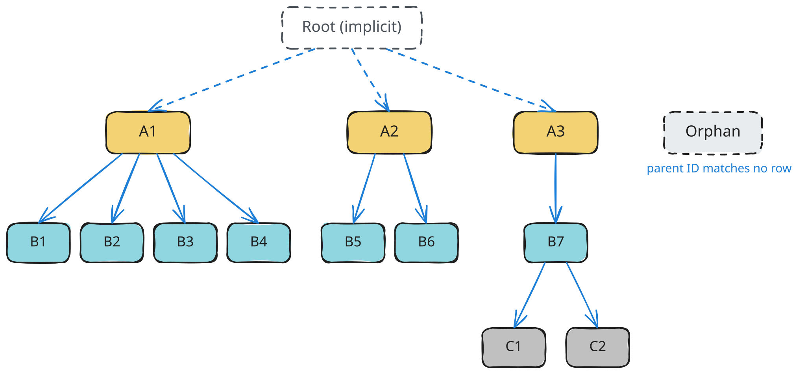

This guide shows you how to create a hierarchical tree table from a table whose rows reference each other through an ID column and a parent column.

If your rows don't reference each other and you instead want to group rows by column values and [aggregate](./combined-aggregations.md) each group, use a [rollup table](./rollup-table.md).

A tree table is a table with an expandable [tree structure](https://en.wikipedia.org/wiki/Tree_(data_structure)). The following diagram shows one:



In computer science, trees are data structures used to represent hierarchical relationships between pieces of data. A tree stores its data in _nodes_. Each box in the diagram above is a node.

Every node except the root (the `Root` box at the top of the diagram) has exactly one parent, and any node can have zero or more children. In the diagram above, `B7`'s parent is `A3`, and its children are `C1` and `C2`.

In a Deephaven tree table, the `Root` node at the top of the diagram is implicit and doesn't correspond to a row. Its children, like `A1`, `A2`, and `A3`, are the rows whose parent is null. These rows are the top-level nodes of the tree.

A row whose parent value isn't null but doesn't match any row's ID, like `Orphan` in the diagram, is an _orphan_. See [Orphan nodes](#orphan-nodes).

## `tree`

Create a tree table with the [`tree`](../reference/table-operations/create/tree.md) method:

```python syntax
result = source.tree(id_col, parent_col, promote_orphans)
```

Where:

- `id_col` is the name of the column that contains the unique identifier for each node in the tree.
- `parent_col` is the name of the column that contains the identifier of each node's parent. Rows with a null parent are top-level nodes.
- `promote_orphans` is an optional boolean. When it is `True`, [orphans](#orphan-nodes) appear as top-level nodes with their descendants beneath them. When it is `False`, the default, orphans and their descendants are left out.

A row is a child of the row whose ID matches the row's parent value. The ID and parent columns must have the same data type.

The source table can be static or [ticking](../conceptual/table-types.md), but [`tree`](../reference/table-operations/create/tree.md) doesn't support [blink tables](../conceptual/table-types.md#specialization-3-blink). See [Unsupported operations](../conceptual/table-types.md#unsupported-operations).

The resulting table initially shows only the top-level rows, collapsed. Click a row to expand it and show its children.


[`tree`](../reference/table-operations/create/tree.md) returns a [`TreeTable`](/core/pydoc/code/deephaven.table.html#deephaven.table.TreeTable), not a table, so you filter and sort it with its own methods. To filter it, use [`with_filters`](/core/pydoc/code/deephaven.table.html#deephaven.table.TreeTable.with_filters). To sort or filter the rows within each node, record the operations with [`node_operation_recorder`](/core/pydoc/code/deephaven.table.html#deephaven.table.TreeTable.node_operation_recorder) and apply them with [`with_node_operations`](/core/pydoc/code/deephaven.table.html#deephaven.table.TreeTable.with_node_operations).

## Examples

### Static data

The following example creates a `source` table in which each row's `Parent` is its `ID` divided by 4, rounded down. The row with `ID` 0 has a null parent, so it is the only top-level node. The example then builds a tree from the `ID` and `Parent` columns.

```python order=result,source
from deephaven import empty_table

source = empty_table(100).update_view(
    ["ID = i", "Parent = i == 0 ? NULL_INT : (int)(i / 4)"]
)

result = source.tree(id_col="ID", parent_col="Parent")
```

### Real-time data

Because Deephaven tables can [tick](../conceptual/table-types.md), a tree table isn't a static copy of its source. When rows are added to, modified in, or removed from the source table, the tree updates to match, and you don't write any code to rebuild it. The following example builds a ticking tree from three tables:

- `t1` has 10,000 rows with the same kind of `ID`/`Parent` hierarchy as the [static data example](#static-data). Each row's `Parent` is its `ID` divided by 10, rounded down.
- `t2` starts from a [time table](./time-table.md) that adds a row every 10 milliseconds. Its `I` column counts from 0 to 9,999 and then wraps back to 0. [`last_by`](../reference/table-operations/group-and-aggregate/lastBy.md) keeps only the latest row for each `I`, so `t2` never has more than 10,000 rows.
- `source` [joins](../reference/table-operations/join/join.md) `t1` to `t2`, so it contains only the rows whose `ID` matches an `I` value in `t2`.

The tree grows as rows arrive. After `I` wraps back to 0, the tree updates in place instead of growing.

```python ticking-table order=null
from deephaven import empty_table, time_table

t1 = empty_table(10_000).update_view(
    ["ID = i", "Parent = i == 0 ? NULL_INT : (int)(i / 10)"]
)
t2 = time_table("PT0.01S").update_view(["I = i % 10_000"]).last_by("I")

source = t1.join(t2, "ID = I")

result = source.tree(id_col="ID", parent_col="Parent")
```


## Orphan nodes

A row in a tree table is an orphan if both of the following are true:

- The row's parent is _not_ null.
- No row in the table has that parent's ID.

By default, orphans and all of their descendants don't appear in the tree table. To include them, set the `promote_orphans` argument of [`tree`](../reference/table-operations/create/tree.md) to `True`. Promoted orphans become top-level nodes alongside the rows whose parent is null, and their descendants appear beneath them.

In the following example, `source` [merges](../reference/table-operations/merge/merge.md) a 100-row table with a 2-row table. In `source`:

- `ID` values run from 2 to 103.
- The rows with `ID` 2, 102, and 103 have a null parent.
- Every other row's parent is a number from 0 to 8. No row has an `ID` of 0 or 1, so the rows whose parent is 0 or 1 are orphans.
- Some orphans have descendants of their own. The row with `ID` 3 is an orphan, and the rows with `ID` 5, 7, and 9 are among its descendants.

`result_no_orphans` leaves out the orphans and their descendants. `result_with_orphans` shows the orphans as top-level nodes with their descendants beneath them.

```python order=result_no_orphans,result_with_orphans,source
from deephaven import empty_table, merge

source = merge(
    [
        empty_table(100).update_view(
            ["ID = i + 2", "Parent = i == 0 ? NULL_INT : i % 9"]
        ),
        empty_table(2).update_view(["ID = i + 102", "Parent = NULL_INT"]),
    ]
)

result_no_orphans = source.tree(id_col="ID", parent_col="Parent")
result_with_orphans = source.tree(
    id_col="ID", parent_col="Parent", promote_orphans=True
)
```

The following figure shows the end of `source` next to `result_no_orphans`. The rows with `ID` 2, 102, and 103 are top-level nodes. Orphans such as the rows with `ID` 92, 93, and 101, whose parents are 0 or 1, don't appear in the tree.


`result_with_orphans` has more top-level nodes. Besides the rows with `ID` 2, 102, and 103, the promoted orphans are now top-level, including the rows with `ID` 3, 11, and 12. Expand the row with `ID` 3 to see its child, the row with `ID` 5.

## Related documentation

- [Table types](../conceptual/table-types.md)
- [Create a hierarchical rollup table](./rollup-table.md)
- [Multi-aggregation](./combined-aggregations.md)
- [Create static tables](./new-and-empty-table.md#empty_table)
- [How to create a time table](./time-table.md)
- [Exact and relational joins](./joins-exact-relational.md)
- [Inexact, time-series, and range joins](./joins-timeseries-range.md)
- [Merge tables](./merge-tables.md)
- [`empty_table`](../reference/table-operations/create/emptyTable.md)
- [`join`](../reference/table-operations/join/join.md)
- [`last_by`](../reference/table-operations/group-and-aggregate/lastBy.md)
- [`merge`](../reference/table-operations/merge/merge.md)
- [`time_table`](../reference/table-operations/create/timeTable.md)
- [`tree`](../reference/table-operations/create/tree.md)
- [`update_view`](../reference/table-operations/select/update-view.md)
- [`tree` Pydoc](/core/pydoc/code/deephaven.table.html#deephaven.table.Table.tree)
- [`TreeTable` Pydoc](/core/pydoc/code/deephaven.table.html#deephaven.table.TreeTable)
- [`TreeTable.with_filters` Pydoc](/core/pydoc/code/deephaven.table.html#deephaven.table.TreeTable.with_filters)
- [`TreeTable.node_operation_recorder` Pydoc](/core/pydoc/code/deephaven.table.html#deephaven.table.TreeTable.node_operation_recorder)
- [`TreeTable.with_node_operations` Pydoc](/core/pydoc/code/deephaven.table.html#deephaven.table.TreeTable.with_node_operations)
